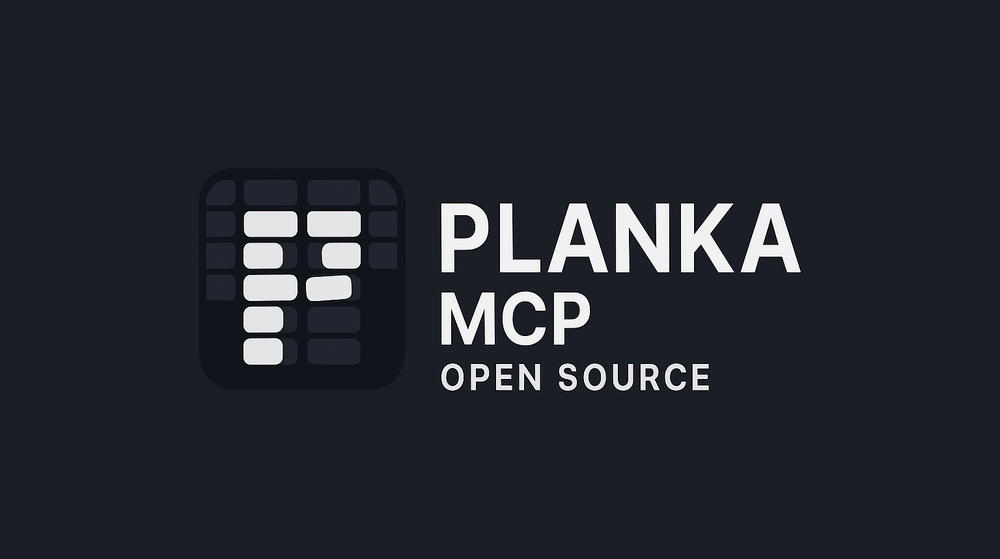

# Planka MCP



**Manage your [Planka](https://planka.app/) Kanban boards directly through AI assistants using the Model Context Protocol (MCP).**

Create and manage boards, lists, cards, and labels from any MCP-compatible client.

[](https://github.com/plankanban/planka)
[](https://modelcontextprotocol.io/)
[](https://www.npmjs.com/package/planka-mcp)

## Features

- **Planka v2 support** - Integrates with the Planka v2 API.
- **Board management** - Access and manage your Kanban boards.
- **List management** - Create and organize lists.
- **Card management** - Manage cards and their contents.
- **Label management** - Work with board labels.
- **Dynamic tool registration** - MCP tools are registered dynamically.
- **Easy configuration** - Supports environment variables and `.env` files.
- **CLI support** - Run directly through `npx`.

## Quick Start

The easiest way to use Planka MCP is through an MCP-compatible editor such as VS Code, Cursor, or Windsurf.

### 1. Configure your MCP client

Add the following configuration to your `.vscode/mcp.json` file:

```json
{
  "servers": {
    "planka": {
      "type": "stdio",
      "command": "npx",
      "args": ["-y", "planka-mcp"],
      "env": {
        "PLANKA_EMAIL_OR_USERNAME": "your-email-or-username",
        "PLANKA_PASSWORD": "your-password",
        "PLANKA_API_URL": "https://your-planka-instance.com/api"
      }
    }
  }
}
```

Replace the example values with your Planka credentials and API URL.

### 2. Install the package

The package is published publicly on [npm](https://www.npmjs.com/package/planka-mcp), so no registry authentication is needed. `npx` will download it automatically.

If you prefer a global install:

```bash
npm install -g planka-mcp
```

### 3. Start the server

Once configured, start the MCP server from your editor.

You can also run it directly:

```bash
npx -y planka-mcp
```

The server communicates over STDIO and can be used by any compatible MCP client.

## Configuration

The following environment variables are required:

| Variable                   | Description                            |
| -------------------------- | -------------------------------------- |
| `PLANKA_EMAIL_OR_USERNAME` | Your Planka email address or username. |
| `PLANKA_PASSWORD`          | Your Planka password.                  |
| `PLANKA_API_URL`           | The API URL of your Planka instance.   |

Alternatively, create a `.env` file in the project root:

```env
PLANKA_EMAIL_OR_USERNAME=admin
PLANKA_PASSWORD=admin
PLANKA_API_URL=http://localhost:1337/api
```

## Development

Want to contribute or run the server locally?

### Prerequisites

- Node.js
- npm
- A running Planka v2 instance

### 1. Clone the repository

```bash
git clone https://github.com/HexiDev/planka-mcp.git
cd planka-mcp
```

### 2. Install dependencies

```bash
npm install
```

### 3. Configure environment variables

Create a `.env` file in the project root:

```env
PLANKA_EMAIL_OR_USERNAME=admin
PLANKA_PASSWORD=admin
PLANKA_API_URL=http://localhost:1337/api
```

### 4. Build the project

```bash
npm run build
```

### 5. Run the server

```bash
node dist/index.js
```

### VS Code development configuration

To run your local build through VS Code, add the following to `.vscode/mcp.json`:

```json
{
  "servers": {
    "planka": {
      "type": "stdio",
      "command": "node",
      "args": ["${workspaceFolder}/dist/index.js"],
      "env": {
        "PLANKA_EMAIL_OR_USERNAME": "admin",
        "PLANKA_PASSWORD": "admin",
        "PLANKA_API_URL": "http://localhost:1337/api"
      }
    }
  }
}
```

## Compatibility

| Component | Support                      |
| --------- | ---------------------------- |
| Planka    | v2                           |
| Protocol  | Model Context Protocol (MCP) |
| Transport | STDIO                        |
| Runtime   | Node.js                      |
| Package   | npm (public)                 |

Other MCP-compatible clients should work with the same STDIO configuration, although VS Code is currently the primary tested integration.

## License

See [LICENSE](LICENSE) for details.

---

**Developed by [HexiDev](https://hexmedia.nl/)**
